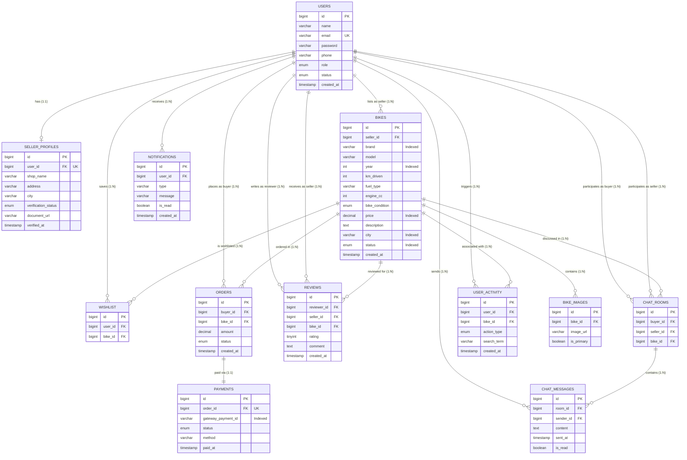

# BikeHub – Entity-Relationship (ER) Architecture

## 1. ER Diagram (Mermaid)

## 2. Cardinality & Relationship Breakdown

| Relationship | Entities Involved | Cardinality | Business Logic & Integrity Constraints |
|:---|:---|:---|:---|
| **User & Seller Profile** | `users` &harr; `seller_profiles` | **1 : 0..1** (Strict 1:1) | A user can opt to become a seller. `user_id` has a unique constraint. If a user is deleted, their seller profile cascades (`ON DELETE CASCADE`). |
| **Seller & Bikes** | `users` &harr; `bikes` | **1 : N** | A verified seller lists 0 to many bikes. Each bike is owned by exactly 1 seller (`seller_id`). |
| **Bike & Images** | `bikes` &harr; `bike_images` | **1 : N** | Each bike has 1 or more images. Exactly one image has `is_primary = TRUE` for catalog thumbnails. |
| **Buyer & Wishlist** | `users` &harr; `wishlist` &harr; `bikes` | **M : N** | A buyer can bookmark many bikes; a bike can be saved by many buyers. Unique constraint `(user_id, bike_id)` prevents duplicates. |
| **Buyer, Bike & Order** | `users`, `bikes` &harr; `orders` | **1 : N** | A buyer can place orders. A bike can be purchased in an order. `ON DELETE RESTRICT` protects purchase audits. |
| **Order & Payment** | `orders` &harr; `payments` | **1 : 1** | Exactly one payment record exists per order (`order_id` is unique in `payments`). Tracks Razorpay/Stripe transaction ID and method. |
| **Reviewer, Seller & Bike** | `users`, `bikes` &harr; `reviews` | **1 : N** | A buyer can review a seller after purchase. Rating is constrained `BETWEEN 1 AND 5`. |
| **Chat Room & Messages** | `users`, `bikes`, `chat_rooms` &harr; `chat_messages` | **1 : N** | A room is unique per `(buyer_id, seller_id, bike_id)`. Contains sequential messages ordered by timestamp. |
| **User & Notifications** | `users` &harr; `notifications` | **1 : N** | Real-time push notifications for order updates, seller verifications, and chat alerts. |
| **User Activity** | `users`, `bikes` &harr; `user_activity` | **1 : N** | Captures interaction events (`VIEW`, `SEARCH`, `WISHLIST`, `CHAT`) for the AI content-based recommendation engine. |

## 3. Database Normalization (3NF) Compliance

1. **First Normal Form (1NF)**:
   - All attributes contain atomic values (no comma-separated image URLs or arrays; images are stored in a dedicated `bike_images` table).
   - Each table has a designated primary key (`id` with auto-increment).
2. **Second Normal Form (2NF)**:
   - All non-key columns depend on the entire primary key, eliminating partial dependencies.
3. **Third Normal Form (3NF)**:
   - No transitive dependencies exist. For example, seller business details (`shop_name`, `address`, `city`) reside in `seller_profiles`, not duplicated inside the `bikes` or `users` tables.
